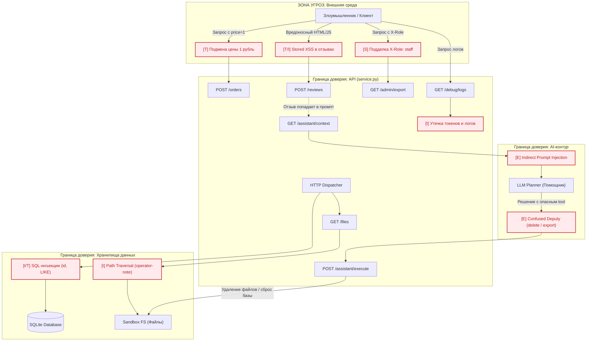

# Threat Model (STRIDE) for Local Shop + LLM Integration

## System Overview and Trust Boundaries

- Untrusted Zone (External):
  - Browser/HTTP client of end-users (including attackers).
  - User-generated content: product reviews (potentially hostile input).

- API Perimeter (service.py):
  - HTTP endpoints: `/health`, `/products`, `/login`, `/profile`, `/search`, `/orders`, `/admin/export`, `/files`, `/debug/logs`, `/reviews`, `/reviews/view`, `/assistant/context`, `/assistant/execute`.
  - Session store in memory: `self.sessions` with `X-Token` as bearer token.

- Data Stores:
  - In-memory SQLite DB: tables `profiles`, `orders`.
  - Filesystem sandbox (sandbox.py): `files/<username>/...`, `private/...` under a temporary root.

- AI Contour:
  - Context formation in `/assistant/context` (orders + reviews + user query → prompt string).
  - LLM Planner (external decision-maker) that reads prompt and outputs a tool call `{tool, arguments}`.
  - Tool execution in `/assistant/execute` (server-side, must enforce authz).

## Data Flow Diagram (Mermaid)

Notes:
- All arrows represent data flowing across trust boundaries; server must validate/authorize at the API boundary.
- The LLM Planner is an untrusted decision source; its outputs require backend authorization checks.

## STRIDE Threat Matrix

| Cat. | Component | Threat & Attack Vector | Mitigations (Implemented) |
|---|---|---|---|
| S | API `/admin/export` | Spoofing staff via client-controlled header `X-Role` | Server-side session/role check via `X-Token`; ignore client role headers |
| S | Sessions | Token theft via logs or XSS could impersonate users | Restrict `/debug/logs` to staff; escape reviews; minimize sensitive logging |
| T | `/orders` | Tampering with price by client-supplied `price` | Ignore client `price`; use catalog `self.products[product]` only |
| T | `/files`, `/assistant/execute` | Path traversal to other users/private | Normalize path; ensure `allowed_root in parents` and `is_file`; forbid `private` |
| R | API error handling | Detailed error messages aid attackers (recon) | Consider generic error responses (note: mitigation guidance; optional) |
| I | `/debug/logs` | Information disclosure of headers, bodies (tokens, PII) | Restrict logs to staff session; avoid exposing sensitive data |
| I | `/orders`, `/profile`, `/search` | SQLi to exfiltrate DB | Parameterized SQL; strict `int()` validation for IDs; LIKE parameterization |
| D | Global | Abuse with high-rate requests (DoS) | Basic body-size limit; can add rate-limits (guidance) |
| E | `/assistant/execute` | Elevation via Confused Deputy (LLM instructs privileged tools) | Enforce authz on backend: `export_profiles`/`delete_tree` require `staff`; scope `read_file` to user dir |
| E | AI Planner | Indirect Prompt Injection (reviews inject instructions) | Treat planner output as untrusted; server validates tool and arguments; escape reviews in UI |

AI-specific risks (details):
- Indirect Prompt Injection: attacker posts a review with hidden prompts; the LLM planner may output `export_profiles` or `delete_tree`. Backend must reject or constrain based on the caller’s session/role and allowlist.
- Confused Deputy: the planner becomes a deputy executing actions the user is not allowed to perform. Only backend authorization cures this; prompts and guidelines are insufficient as a control.

## Defense-in-Depth Principle

LLM decisions and all user-originated inputs are untrusted. Defense in depth requires:
- Server-side authorization for every tool and sensitive endpoint, independent of prompts or UI constraints.
- Parameterized DB access and strict input validation at the API boundary.
- Filesystem access restricted to per-user directories; traversal prevented.
- Output encoding (e.g., escaping reviews) to prevent XSS even if input sanitation fails.

This layered approach ensures that even if the LLM planner is influenced by prompt injection, the server remains the final arbiter of privileges and data access.
